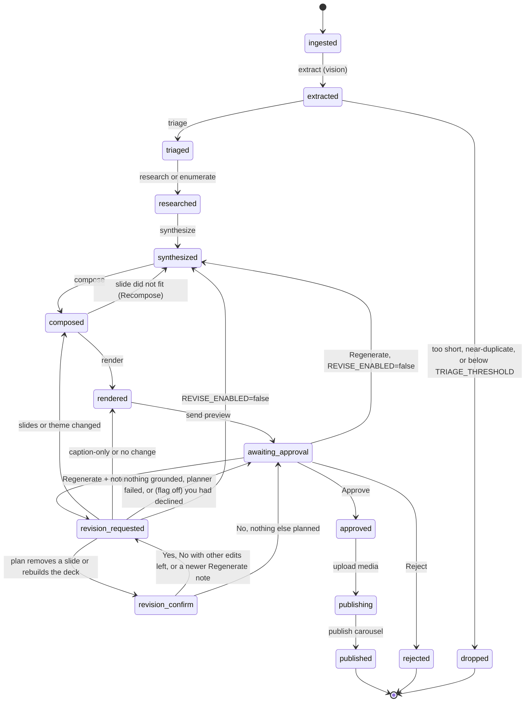

# Architecture

## What this is

One long-lived Python process that turns Telegram posts into published
Instagram carousels, with a human approval gate in the middle. It is a
**queue with a state machine**, not a request/response service: every unit of
work is a row in SQLite, and every stage is a function that moves one row
forward.

There is no message broker, no external scheduler, and no second service. That
is deliberate — see [Why one process](#why-one-process).

`src/pipeline/__main__.py` starts everything in one asyncio loop: the Telethon
channel listener, the aiogram approval bot, the two worker loops, the media
tunnel supervisor (when `MANAGE_TUNNEL` is on), and three periodic jobs — a
daily digest, an Instagram token check every 12 hours, and the
[retention](retention.md) sweep. Where that process runs — Docker, not
launchd — is covered in [Running in Docker](#running-in-docker).

## The flow

```
 Telegram channel ─┐
 DM to the bot   ──┼──▶ ingested ──▶ extracted ──▶ triaged ──▶ researched ──▶ synthesized
 Dashboard "new" ──┘                  (vision)     (score)     (SearXNG)       (brief)
                                                                                  │
                                                                                  ▼
  published ◀── publishing ◀── approved ◀── awaiting_approval ◀── rendered ◀── composed
   (Graph)      (containers)    (upload)       you decide           (PNG)     (slide JSON)
                                                  │    ▲
                                       Regenerate │    │ targeted edits, re-previewed
                                                  ▼    │
                                              revision_requested ⇄ revision_confirm
```

Every arrow is one stage function. Stages return field updates and the worker
writes them, so any stage can be re-run in isolation. As a rule stages do not
call each other — the worker sequences them. There are two deliberate
exceptions: the revise stage calls `compose()` directly for `/skip`, render
overflow, a deck with no slides and a confirmed whole-deck rebuild
(`stages/revise.py`, `_fallback`), and the `triaged` stage
(`__main__.research_or_enumerate`) runs `enumerate_items` and, for a news or
explainer item, `research` in one step. The full transition graph is below.

## The state machine is the schema

`items.status` **is** the state machine (`src/pipeline/models.py`). There is no
separate queue table, no job registry, and no in-memory state that matters.
Restarting the process loses nothing.

Copies are found by `items.text_hash` (`db.text_hash`: lower case, punctuation
and spacing collapsed, markdown links `[text](url)` unwrapped to their text,
since Telethon renders a channel post's links that way and a forward of it is
plain) within 48 hours, via `db.recent_copy`. Triage drops a channel copy; DM
intake answers a copy with the item it matches and creates nothing, unless that
item was dropped, failed or rejected (a resend is then a retry). Text under 40
characters never counts as a copy.



Not drawn, because they apply to every worker-owned status:

- **`needs_input`** — any stage may raise `NeedsInput` (`src/pipeline/conversation.py`):
  the item parks, the operator is asked a question, and the answer resumes it
  at `resume_status` (or rejects it).
- **`failed`** — a `Terminal` error, or `max_attempts` (3) retryable failures.
- **requeue** — `scripts/requeue.py` sends an item back to an earlier stage and
  clears what that stage produces (`src/pipeline/requeue.py`).
- **retention** — the sweep auto-rejects items left in `awaiting_approval`
  longer than `AWAITING_APPROVAL_MAX_DAYS` (see [retention](retention.md)).

A Regenerate may start from `awaiting_approval` or `revision_confirm` in
Telegram (`approval/bot.py`, `REGEN_FROM`); a newer note replaces the open
Yes/No question. The dashboard also allows it from `failed` and `rejected`
([revision-api](revision-api.md#dashboard-scriptsdashboardpy)).

| Status | Meaning | Advanced by |
|---|---|---|
| `ingested` | raw text/media captured | extract |
| `extracted` | images described by a vision model | triage |
| `triaged` | scored for researchability | research *or* enumerate |
| `researched` | notes gathered and relevance-gated | synthesize |
| `synthesized` | a written brief exists | compose |
| `composed` | slide JSON exists | render |
| `rendered` | PNGs on disk | send preview |
| `awaiting_approval` | **waiting on you** | the approval bot / dashboard only |
| `revision_requested` | you asked for changes to the preview | revise |
| `revision_confirm` | **waiting on your Yes/No** for a destructive edit | `confirm_revision`, or a newer Regenerate note |
| `approved` | you said yes | upload to storage |
| `publishing` | media uploaded, containers next | publish |
| `published` | live on Instagram (or a `DRYRUN-<id>` record in dry run) | — |
| `needs_input` | **waiting on your answer** | your reply only |
| `rejected` / `dropped` / `failed` | terminal | — |

`WORKER_HALTS` is the set the worker will not touch: the four terminals
(`published`, `dropped`, `rejected`, `failed`) plus the three human gates
(`awaiting_approval`, `needs_input`, `revision_confirm`). The worker filters
them out of its registry even if a caller passes one in, so a registry mistake
cannot open a human gate. Every other status must have a stage in
`build_stage_registry()`; `missing_statuses()` raises at startup if one does
not — a status with no stage would strand items silently.

### Extraction runs before triage

Counter-intuitive, and load-bearing. Many channel posts are an image with no
caption. Triaging on body text alone dropped those unread and reported it as a
quiet channel. The cost is one vision call per post *ahead of* the filter,
which is the price of not being blind.

The vision model reads stills only. A channel video is replaced at intake by
one representative frame (`intake/channel.video_frame`: `ffmpeg`, scaled to
1280 wide before the `thumbnail` filter to bound memory, 60 s timeout); the
clip itself is not kept. A DM keeps the largest photo size, or an image sent as
a file (JPEG, PNG, WebP).

## The worker

Two loops over the same registry, split by latency class (`src/pipeline/worker.py`):

```python
FAST_STAGES = frozenset({Status.APPROVED, Status.PUBLISHING})

run_slow(interval=5s)   # everything else
run_fast(interval=2s)   # approve → publish
```

They were one loop until a 983-second compose blocked every approval behind it.
`tick()` claims a batch and gathers it, so one slow item stalls the batch;
splitting the stages that a human is waiting on into their own loop bounds that.

A stage may return three reserved keys alongside its field updates: `_next`
(override the default next status), `_detail` (a line for the `events`
timeline) and `_after` (a callback run only after the transition commits — how
the revise stage tells you about a state that already exists in the DB).

### Failure taxonomy

`src/pipeline/errors.py` defines how a stage fails (with `NeedsInput`, which
lives in `src/pipeline/conversation.py`), and the worker acts on the type —
not on a string match:

| Exception | Worker behaviour |
|---|---|
| `Survivable` | log, continue with partial results |
| `Retryable` | retry, counting against `max_attempts` (3) |
| `BadCompletion` (⊂ `Retryable`) | the model returned something unusable |
| `Retryforever` (⊂ `Retryable`) | defer **without** spending an attempt — infrastructure, not the item. Default delay 60 s, or the raiser's `retry_after_s` |
| `RateLimited` (⊂ `Retryforever`) | provider throttling; the LLM client retries, then falls back to local |
| `ConfigFault` (⊂ `Retryforever`) | a missing model, a dead slug, a disabled search format: deferred, and the operator is alerted **once per fault per process** (`src/pipeline/faults.py`) |
| `EnginesBlocked` (⊂ `Retryforever`) | a search came back empty *and* an engine reported itself suspended — an empty result that is not a finding |
| `PlatformThrottled` (⊂ `Retryforever`) | Instagram is throttling the account (see [Publishing](#publishing)) |
| `Terminal` | stop permanently (`failed`), notify |
| `Recompose` | a slide did not fit: back to `synthesized` with a "shorten slide N" note; after 5 in a row (`MAX_RECOMPOSES`) the item fails and the operator is alerted |
| `NeedsInput` | ask the operator, park in `needs_input` |

The distinction that matters most: **an outage must not spend the item's retry
budget**. A dead SearXNG is down for every item, so charging one item three
attempts for it turns an infrastructure blip into permanent content loss. No
quality gate fails open on an outage either: a gate that cannot run defers the
item rather than passing it.

## Models: three roles, plus a local verifier

Every call asks for a *role* — `cheap`, `good`, or `vision` — and the client
(`src/pipeline/llm.py`) resolves it. Each role has an OpenRouter model and a
local Ollama model, and `Settings.provider_for(role)` decides which provider
serves it: `LLM_PROVIDER`, unless a per-role `LLM_PROVIDER_CHEAP/GOOD/VISION`
overrides it.

```
llm.cheap(...)   triage · relevance gate · research notes · query expansion · coverage
llm.good(...)    synthesize · compose · enumerate · revision planner and edits
llm.vision(...)  extract
llm.verify(...)  advisory pre-render check — always local Ollama, never routed
```

`cheap` does far more than its name suggests: it writes the research notes that
become the deck's facts, and it operates every quality gate. A weak `cheap`
model does not produce visibly broken output — it produces undifferentiated
output, which is worse, because every downstream threshold then passes
everything.

The OpenRouter path degrades in a ladder: JSON schema → `json_object` with the
schema in the prompt (for models that reject `json_schema`) → three attempts in
all → the local Ollama chain (`MODEL_<ROLE>`, then `MODEL_<ROLE>_FALLBACK` if
set), when `FALLBACK_TO_LOCAL` is on. A 4xx about our own request is excluded
from retry; a wrong slug is a `ConfigFault` and skips straight to local.
Startup refuses paid slugs and auto-router slugs (`openrouter/...`) for any
role that resolves to OpenRouter (`validate_model_config` in
`src/pipeline/config.py`).

The verifier (`src/pipeline/verify.py`, `VERIFY`) runs at the end of compose
and writes `items.verification`. It is advisory: it gates nothing, and its
failure never fails compose.

## Research

```
plan_queries ──▶ expand_queries ──▶ search_many ──▶ fetch ──▶ relevance gate ──▶ notes
  (entity +        (4 → ~16)        (SearXNG)     (trafilatura)   (llm.cheap)
   clauses)
```

`enumerate_items.classify` first sorts the request into one of three intents:
**news** (a claim to verify), **explain** (one subject: "what is X", "how does
X work", "X vs Y", or a bare link) and **list** (a set to enumerate). News and
explain take the research path above, with the classifier's plan passed in as
hints; list takes the enumeration path. An explain item is stored as
`intent = "news"`, because downstream only tells "list" from everything else.

For a news item (not an explainer), each researcher also asks Bing News RSS
(`search.news_search`) and reads those articles before SearXNG's results: from
one home IP SearXNG's general engines sit CAPTCHA-suspended, and the Bing
scraper left answering drops rare words, so a story's own coverage came back
as song links and the Microsoft homepage (T379). A failed news search is just
empty; a CAPTCHA-blocked SearXNG does not sink a researcher that has news.

Any item reads the pages it linked (a DM's links or a `needs_input` answer;
for a channel post, usually the article itself; at most two) as **primary
notes**: one note per page, written from that page alone and not put through
the relevance gate. With one, a single note is enough. Channel posts were
excluded until items 739 and 740 failed holding their whole articles, because
a day-old story had no independent coverage yet (T377).

For an operator DM, research also:

- puts results from the linked hosts first;
- cuts search queries to six words with the bare subject first
  (`shape_queries`), because long keyword strings return nothing;
- drops notes the model marks as not answering the request;
- needs one note instead of two when it has a primary page or is an explainer,
  and asks the operator (with `/post` when it has something) instead of
  retrying when it falls short. A channel item with no readable link keeps
  two notes and the retry;
- asks about unanswered parts of the request only when *none* was answered.
  A forwarded story's unconfirmed side claim goes to compose as a `gap` (the
  `/post` path), not to the operator.

The hook background is an image search for the planner's `image_query`. A
result is used only if its title names the subject (`shows_subject`: a word of
three or more letters from the bare subject); otherwise the deck has no
background. The first hit used to win, which put "Motivational Speaker
Presenting at Conference" behind a Jensen Huang story.

Two catalogues, chosen by intent:

- **news** — `SEARXNG_CATEGORIES` (default `general,it,news`), deduped by
  domain (five pages from one publisher is one source).
- **repos** — `engines=github`, deduped by path (twenty github.com results are
  twenty different answers, not one source repeated).

Single-engine searches are **serialised and paced** (`SINGLE_ENGINE_INTERVAL_S`
in `src/pipeline/search.py`). GitHub's unauthenticated search API allows
roughly ten requests a minute; sixteen expanded queries fired four at a time
earned a 403, and SearXNG suspends a 403ing engine for 180 seconds while
continuing to answer 200 with an empty result list. Pacing costs wall-clock and
buys correctness. No query is dropped.

`search_many` keeps partial results when an outage starts mid-batch, and raises
only when nothing came back at all. A researcher whose query was emptied by a
suspended engine counts as empty, not as an outage, unless no researcher found
anything.

### Fetching untrusted URLs (SSRF guard)

Every URL that comes out of a search result is attacker-influenced, so every
public fetch — article text (`search.fetch_text`), background images
(`search.download_image`), avatars (`search.download_avatar`) and revision
image swaps (`safe_download.download_public_image`) — goes through one
function, `safe_download.fetch_public(http, url, policy)`, which applies the
same network guards to all of them:

- http/https on ports 80/443 only, no credentials in the URL;
- every address the host resolves to must be public (loopback, private,
  link-local, CGNAT, multicast and reserved are refused);
- redirects are followed by hand, at most 3, each hop re-checked, and
  https → http is refused;
- bodies are streamed under a per-policy byte cap and one wall-clock deadline;
  pages may inflate one gzip/deflate layer under the same cap.

What happens to the bytes afterwards differs by caller, and is weaker for the
older two:

| Caller | Content-Type accepted | Checked after decode |
|---|---|---|
| revision image swap (`IMAGE_POLICY`, `safe_download._decode`) | `image/*` | jpeg/png/webp only; pixel count; long-edge and short-edge minimums; aspect ratio ≤ 3:1; full decode |
| research background (`BACKGROUND_POLICY`) | `image/*` or `application/octet-stream` / `binary/octet-stream` | jpeg/png/webp only; pixel count; long-edge minimum. **No** aspect check |
| avatar / repo logo (`AVATAR_POLICY`) | same as background | pixel count; short-edge minimum. Any format Pillow opens |
| article page (`PAGE_POLICY`) | `text/*`, xhtml, xml, or none | extracted by trafilatura |

DNS rebinding is closed at the socket: the shared httpx client uses a
`RoutingTransport` that sends public-only requests through a pinned transport,
which resolves the name inside the connect, vets every address, and dials the
vetted IP while keeping Host, SNI and certificate checks. Traffic to SearXNG,
Ollama and Telegram uses the normal transport. A refused page falls back to the
search snippet, as an unreachable one always has.

## Composition and rendering

`compose` emits slide JSON against a schema of 15 slide types (`hook`, `point`,
`repo`, `facts`, `kpi`, `chart`, `notes`, `flow`, `compare`, `quote`, `photo`,
`links`, `takeaway`, `sources`, `follow`; `src/pipeline/deck_shape.py`), 3 to 10
slides. A `notes` slide carries a Markdown body that is rendered, never shown
as source: no JSON, YAML or code blocks reach a slide. The legacy `code` type
(older decks, model slips) is converted to prose at render time
(`src/pipeline/rich_text.py`, sanitised, raw HTML off). `normalise_slides` then enforces what a JSON schema cannot: ordering,
uniqueness, and that **every slide has body content** — a headline alone
renders as text on an empty 1080×1350 field. Integrity checks
(`src/pipeline/integrity.py`) drop links, repos and figures that the research
material does not back, and record what they dropped in `items.integrity`.

The prompt says when each type fits, and code backs the two it most often
misused: a `flow` whose steps are labelled only "1", "2" (not a sequence, a
list), or a `facts` table with fewer than two rows whose value is not just its
label, becomes a `point` slide (`_point_if_misfit`). A year label ("2019")
keeps a timeline a flow. The cover leads with the stake, and the closing
`follow` slide asks the reader to save or share ("Save this for later"); the
caption's first line names the subject in searchable words and ends on a
question.

Rendering is Jinja2 → HTML → Chromium screenshot (in a subprocess,
`src/pipeline/render_worker.py`), one PNG per slide, with an automatic shrink
pass (`data-shrink`) when content overflows. That shrink pass is why text is
never truncated to fit: the slide gets smaller type instead of a cut-off
sentence. A slide that still does not fit raises `Recompose`. Shrink also
makes a photo smaller, and a photo always sits inside its box's border: before
both, a tall photo overflowed whatever the copy said, and decks bounced
through recompose for hours (item 574: 288 times).

Theme precedence at render time (`render.wanted_theme`): the item's
`theme_pin` (set by a revision) → the `THEME` setting (a name, `rotate` or
`random`) → the composer's pick in `items.theme`. Themes live in
`config/themes/`; see [themes](themes.md).

## Agentic Regenerate (revision)

Pressing Regenerate on a preview and replying with a note ("make slide 3
shorter, swap the image on slide 2") does not recompose the deck. The item
moves to `revision_requested` and the revise stage (`src/pipeline/stages/revise.py`,
package `src/pipeline/revision/`) turns the note into targeted edits:

1. **Plan** (`revision/plan.py`). A rules parser runs first and alone produces
   the structural actions — `remove_slide`, `reorder`, `set_theme`,
   `full_recompose` — only from explicit, negation-aware phrasing. Whatever the
   rules do not explain goes to at most two `llm.good` calls, which may plan
   only `edit_slide`, `add_slide`, `rewrite_caption`, `research`, `fix_fact`,
   `replace_image` and `remove_image`. Every planned action must be traceable
   to the note. The action vocabulary is one registry, `ACTION_SPECS` in
   `revision/model.py`.
2. **Confirm.** A plan that removes a slide or rebuilds the whole deck parks
   the item in `revision_confirm` and asks you Yes/No with a one-time token.
   No drops those actions and runs the rest. Nothing destructive runs without
   your Yes. Sending a newer Regenerate note instead replaces the question
   (its buttons then answer "out of date").
3. **Execute** (`revision/execute.py`): fetch → image → text → structural,
   with slides addressed by stable ids so removing slide 2 cannot retarget an
   edit to slide 5. Text edits pass the same integrity gates as compose
   (`revision/text_edit.py`); web fetches use the SSRF guard and the strictest
   image checks above (`revision/fetch.py`); structural ops are pure code
   (`revision/structural.py`). Slides no action targeted stay byte-identical.
4. **Check** (`revision/check.py`): code checks plus one judge call report
   `satisfied`, `partial`, `unsatisfied` or `unchecked`. An unreadable judge
   reply is `unchecked`, never `satisfied`. At most one replan; never an
   automatic full recompose.
5. **Record and re-preview.** Each run is kept in `items.revision` (last 10
   runs); the new preview opens with a "Changes" block built from it
   (`revision/copy.py`). Slides or theme changed → `composed` (re-render);
   caption-only → `rendered`.

If nothing in the note can be grounded — including a planner that fails twice
when the rules found nothing either — nothing is touched and you are asked
what you meant; the old preview stays valid. (When the planner fails but the
rules did find actions, those run.) `/skip` asks for a fresh full version
(compose with the previous deck in view). Outages defer the revision in
`revision_requested` without spending an attempt; if search engines stay
blocked past `REVISE_ENGINES_BLOCKED_MAX_S`, the search-backed actions are
reported as not done and the rest runs. A slide that overflows after a revision
still goes through the ordinary `Recompose` path.

`REVISE_ENABLED=false` is the rollback switch: a Regenerate note then goes to
`synthesized` as `regen_note` and the deck is recomposed, exactly as before
this feature. An item you had already answered No for goes back to
`awaiting_approval` unchanged instead, so a declined removal is never handed to
a full recompose. Operator wording, the request/confirm API, the run-record
shape and the rollback SQL for parked items are in
[revision-api](revision-api.md); the design is in
[design/agentic-regen](design/agentic-regen.md).

## Publishing

```
approved ──▶ upload to MinIO ──▶ resolve public base ──▶ child containers
                                                              │
   published ◀── media_publish ◀── wait for FINISHED ◀── carousel container
```

Several things here are non-obvious and each cost a real failure:

1. **Containers build asynchronously.** Publishing one second after creating
   the carousel returns `Media ID is not available`. `_await_container` polls
   `status_code` until `FINISHED`.
2. **`ig_post_id` is the double-post guard**, so a requeue must clear it — which
   makes it useless as a record of what went out. `publish_log` is that record,
   append-only, cleared by no stage.
3. **Media URLs must be publicly fetchable.** Meta reports an unreachable host
   as `Only photo or video can be accepted as media type` — a message about
   file formats for what is a DNS problem. A preflight GETs one slide first and
   fails with the host named, and a loopback media base is refused at upload.
   If the host dies after the preflight, that 4xx is `Retryable`, not
   `Terminal`, so the item can recover.
4. **Throttling is the account's state, not the item's.** Meta's action block
   ("User is performing too many actions") fired after about 40 posts in an
   hour, well under the daily cap. Throttle responses — HTTP 429, error codes
   4/9/17/32/613/80002, subcode 2207042, or rate-limit wording — are
   `PlatformThrottled` and retried in 2 hours without spending an attempt;
   code 368 (an abuse block that can last days) waits 24 hours. You get one
   alert per stall, re-armed by the next successful publish. Any other 4xx
   (bad token, bad request) is `Terminal`; a 5xx or a network error is
   `Retryable` (`publish/instagram.py`, `_post`).
5. **Publishes are paced.** At least 180 s between publishes (at most 20 an
   hour), enforced by an in-process lock plus the last `published_at` in the
   DB; a publish that comes too soon defers. Once 50 posts have gone out in the
   last 24 hours, a further publish fails its item (`Terminal`). Constants:
   `IG_*` in `src/pipeline/config.py`, `DAILY_POST_LIMIT` in
   `src/pipeline/publish/instagram.py`.

With `DRY_RUN=true`, upload and publish are skipped: the item still reaches
`published`, with a `DRYRUN-<id>` post id, so the whole path is exercised.

### The media tunnel

Instagram fetches slides from the public internet, so local MinIO needs a public
face. A Cloudflare quick tunnel provides one, but **regenerates its hostname on
every start**. Pinning it in `R2_PUBLIC_BASE` meant the config was stale from
the next restart onward.

So the pipeline owns it: `publish/tunnel.py` supervises `cloudflared`, writes
the live origin to `data/tunnel-origin.txt` (write-then-rename, so an upload
cannot read half a hostname), and uploads resolve the base **per upload**.
`R2_PUBLIC_BASE` remains the fallback, so a named tunnel or a hosted bucket
needs no special case. What cloudflared fronts is `TUNNEL_TARGET` (MinIO's S3
port; `http://localhost:9000` on a bare host, `http://host.docker.internal:9000`
in the worker container).

Three guards make a rotation a non-event:

1. **A live process is not a live tunnel.** cloudflared does not exit when its
   hostname is withdrawn — one ran for 29 hours after going NXDOMAIN, still
   advertising the dead host. The supervisor probes the published origin every
   120 seconds and treats three consecutive failures as death: clear the
   origin, kill cloudflared, let the restart path publish a fresh hostname.
   Any HTTP answer counts as alive; only DNS and connection failures count
   against it.
2. **Stored URLs are re-addressed at publish time.** The object key is
   `items/<id>/<filename>` by construction, so every slide is re-addressed
   against whatever host is live now (`media_host.current_urls`).
3. **A media outage does not spend the item's retry budget.** It is
   `Retryforever`, not `Retryable`. Items 106 and 109 were killed by getting
   this wrong: three attempts against a withdrawn hostname, then `failed`,
   while both decks sat rendered and correct on disk.

## Why one process

The tunnel supervisor was first written as its own launchd job. It exited
`78 / EX_CONFIG` with no output on every attempt — and so did a trivial
`/bin/echo` agent. macOS blocks **newly added** background items until a human
approves them in System Settings, so a second service fails silently until
someone thinks to check.

Running in-process also removes the state where the tunnel is up and the
pipeline is not, or the reverse. The dashboard (`scripts/dashboard.py`) is the
one exception: a separate, optional process reading and writing the same
SQLite file — which is safe only because both run in containers on the same
Docker volume (next section).

## Running in Docker

Status: live since the 2026-11-08 cutover (T353; decision U12 "everything
running in Docker", designed in T346). Supersedes the read-only-snapshot design of T339 (U11).
Developer detail and the cutover runbook:
[design/docker-everything](design/docker-everything.md).

```
 macOS host                         Docker Desktop Linux VM (one kernel)
 ─────────────────────────────      ───────────────────────────────────────────────
 Ollama :11434 (GPU)  ◀── host.docker.internal ──  app (worker, cloudflared child)
 MinIO  :9000 (container, ◀── host.docker.internal ─┘  │    │
         published port)                               │    │ pipeline-state volume (ext4)
                                                       │    └──▶ /app/state/app.db (WAL)
 ./data  (bind)  ◀─────── rw ─────────────────────────┘          telegram.session
   media/ pipeline.log* backups/ worker.lease                     ig_token.json
   tunnel-origin.txt  ◀── ro ── dashboard ──────────────────────▶ same volume, rw
                                   127.0.0.1:8770
 searxng (compose service, reached as http://searxng:8080)
```

**Why the shared database is safe here and was not before (D298 stands).**
SQLite's WAL mode needs every connection on the same kernel: POSIX byte-range
locks and the `-shm` shared-memory mapping are kernel objects. A Docker Desktop
**bind mount** crosses from macOS into the Linux VM over virtiofs, which carries
neither between the two kernels — that is how T338 corrupted the live DB. A
Docker **named volume** is a directory on the VM's own ext4 disk; every
container sees it through the same Linux kernel and page cache, so locks and the
`-shm` mapping are shared exactly as between two processes on one Linux box.
The worker and the dashboard therefore share `app.db` in WAL mode on the
`pipeline-state` volume, and the dashboard keeps full read-write behaviour.
This is first-principles reasoning; spike T347 proves it on this machine
(concurrent writer + reader across two containers, with forced container
recreation) before any cutover.

**What lives where.**

- `pipeline-state` named volume (declared `external`, so `docker compose down -v`
  cannot delete it), mounted at `/app/state` in both containers: `app.db`,
  `telegram.session` (Telethon's session is itself a SQLite file and is written
  constantly) and `ig_token.json` (it sits next to `DB_PATH`). Only SQLite
  files and state that must never be touched by a host process go here.
- `./data` bind mount: `media/`, `pipeline.log*`, `tunnel-origin.txt`,
  `backups/`, `worker.lease`. Plain files with one writer (the worker
  container), host-visible for debugging and backups. The dashboard mounts it
  `:ro`.
- Host services: Ollama stays on the host for the GPU
  (`OLLAMA_HOST=http://host.docker.internal:11434`); MinIO stays the
  container it already is, reached through its published port
  (`S3_ENDPOINT` and `TUNNEL_TARGET` = `http://host.docker.internal:9000`).
  SearXNG is a compose service. cloudflared is installed in the image and still
  supervised in-process.

**Guards.**

1. *Storage guard.* Inside a container (`PIPELINE_IN_CONTAINER=1`, set by the
   image) a read-write `Database.connect`, and the worker's Telethon start,
   refuse unless the file's filesystem (from `/proc/self/mountinfo`) is a local
   Linux one (ext4/xfs/btrfs). A bind mount (virtiofs/fuse) or the container's
   own overlay layer is refused by name.
2. *Single-owner lease.* The worker holds `data/worker.lease` (owner kind,
   instance id, heartbeat every 30 s, stale after 120 s, written
   temp-then-rename). It is acquired before Telethon or the bot starts; a
   worker that finds a fresh lease held by someone else exits; a holder that
   finds the lease no longer names it stops itself. The lease lives on the bind
   mount because it is the one place both the host and the containers can see.
   This is what keeps the Telethon session and the bot token to one process.
3. *Host fence.* On the host, any read-write `Database.connect` (worker,
   host dashboard, `scripts/*.py`) refuses while a container holds a fresh
   lease, so a stray host process cannot create a fresh empty `data/app.db`
   or split the state. Host scripts run as `docker compose exec app python
   scripts/<name>.py`.
4. *Backups out of the VM.* A Docker Desktop reset or "purge data" deletes
   named volumes. The worker writes an hourly consistent copy of `app.db`
   (SQLite backup API, rollback-journal mode, `quick_check`, temp-then-rename;
   the T340 snapshot code) to `data/backups/`, keeping the last 48.

Launchd (`deploy/com.aayush.newspipeline.plist`, `deploy/install-launchd.sh`)
is retired; its plist is kept in `~/Library/LaunchAgents.disabled/` for
rollback. Docker Desktop's
"start when you sign in" plus `restart: unless-stopped` replace `RunAtLoad` and
`KeepAlive`.

## Storage, retention and logs

- `app.db` (`DB_PATH`; `/app/state/app.db` on the `pipeline-state` volume) —
  SQLite (WAL). Tables `items`, `events` (every transition, with a `detail`),
  `messages` (the per-item chat). Revision state lives in nullable JSON columns
  on `items`: `revision_request` and `revision`, plus `theme_pin`. Opened only
  by processes on the same kernel (D298).
- `data/backups/` — hourly rollback-journal copies of `app.db`, last 48 kept.
  The only copies outside the Docker VM.
- `data/media/` — downloads, rendered PNGs, and researched images
  (`data/media/researched/<id>/`: research backgrounds and revision image swaps).
- `ig_token.json` (next to `DB_PATH`) — the refreshed Instagram token record;
  `data/tunnel-origin.txt` — the live tunnel hostname.
- **Retention** deletes files, never rows: published/rejected/dropped items
  after a grace period, failed items after 30 days, and it auto-rejects decks
  left unapproved for 120 days. Rows, captions, slide JSON and publish history
  survive, so dedupe does too. See [retention](retention.md).
- `data/pipeline.log` — rotating, 8 MB × 5. The app owns this file. (Under
  launchd, stdout went to `data/stderr.log`, because a launchd-redirected file
  cannot be rotated; in Docker, stdout goes to `docker compose logs`.)
- Every log handler carries a **redaction filter** (`src/pipeline/logredact.py`).
  `httpx` logs full request URLs at INFO and Meta's read endpoints take the
  access token as a query parameter, which wrote a live token into the log in
  cleartext.

## Design rules this codebase follows

- **The prompt is a hint; the code is a guarantee.** Anything that must hold is
  enforced after the model returns, not asked for in the system prompt.
- **An outage is not a result.** Infrastructure failure must never be recorded
  as a finding about the content, and no gate fails open on one.
- **Never truncate content to fit.** Shrink the type, widen the window, page
  the query — but do not silently drop what was gathered.
- **Evidence over assertion.** A stage reports what it verified, not what it
  attempted; "could not check" is never reported as "checked, fine".
- **No exception text in previews, revision records or revision notices** —
  closed codes and fixed sentences only. (The failure alert still carries it;
  tracked as T318.)
- **A live SQLite database never crosses a kernel boundary** (D298). Host
  processes and containers never share one; containers share one only on a
  named volume.
